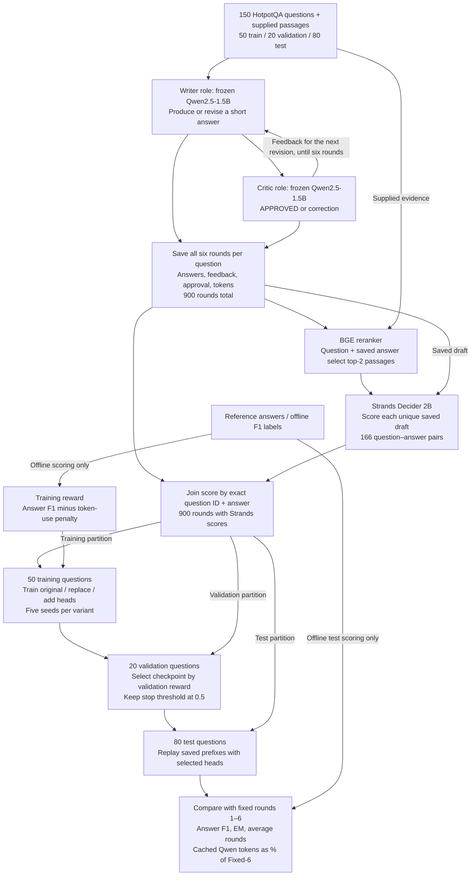
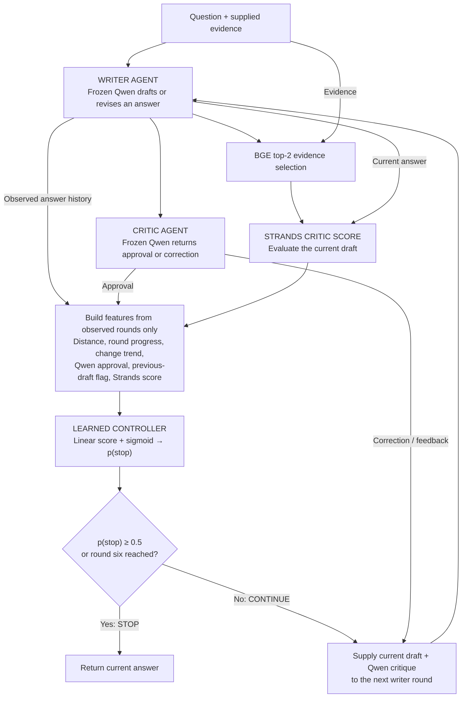
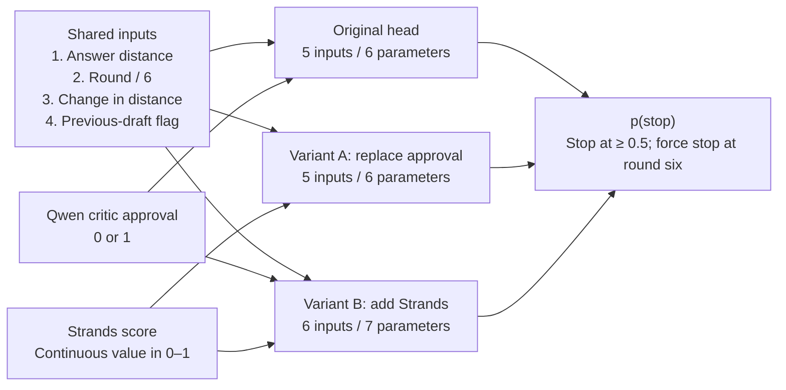

# HaltIQ: writer–critic collaboration with a learned stopping controller

This document distinguishes the **completed cached-trajectory experiment** from the **proposed live integration**. The controller predicts **p(stop)**, not answer correctness.

## 1. Completed experiment: collect, score, train, replay



**What happened:** Qwen generated all six rounds before controller evaluation. Strands subsequently scored the saved drafts. The learned controller selected a stopping point during replay; it did not interrupt collection or cause new answers to be generated.

Gold answers, F1, and EM are used for offline rewards and evaluation only. They are not provided to the writer, critic, reranker, or prediction features. Validation selects checkpoints; test outcomes do not update the weights.

## 2. Proposed live loop: where multi-agent orchestration fits

The diagram shows the **add-Strands variant**. It is a proposed execution schedule, not a live experiment already measured.



The writer and Qwen critic are separate **roles**, even though they share the same frozen model. Strands supplies an additional critic score. The controller orchestrates **whether another revision occurs**; it does not write answers, route tasks among specialists, or determine when an unrelated customer conversation should end.

Only a live run would establish which calls are actually avoided. The two critic paths are logically separate; this diagram does not claim they were executed concurrently.

## 3. Three classifier variants



The shared-input list above groups features for readability; the code preserves the trained feature order:

| Variant | Exact feature order |
|---|---|
| Original | distance, round_fraction, distance_delta, critic_approved, has_previous_draft |
| A: replace | distance, round_fraction, distance_delta, strands, has_previous_draft |
| B: add | distance, round_fraction, distance_delta, critic_approved, has_previous_draft, strands |

**Replacing a feature is not replacing the live feedback loop.** Variant A removes Qwen approval from the controller's inputs, but the saved later drafts were still generated using Qwen critic feedback. A future implementation could obtain the Strands score before deciding whether a Qwen critique is needed for another revision. That schedule and its full cost require separate validation.

## 4. Prediction interface and decision rule

```python
from classifier import StopPredictor

controller = StopPredictor("classifier/results/add/seed0/stop_head.pt")
p_stop = controller.predict(question, rounds_so_far)
stop = controller.should_stop(question, rounds_so_far)
```

Each observed round supplies answer text, a Strands score for variants A/B, and Boolean Qwen approval for original/B. The controller uses no future rounds or gold labels. `question` is retained for interface compatibility; the linear head does not embed its text. Round progress uses the saved cap of six, not the current prefix length.

```text
z = sum(weight × input) + bias
p(stop) = sigmoid(z)
stop = (p(stop) >= 0.5) OR (round == 6)
```

## 5. Measured outcome and cost boundary

All three variants stopped after round one on all 80 test questions across five seeds:

| Variant | Answer F1 | EM | Average rounds | Qwen tokens (% of six rounds) |
|---|---:|---:|---:|---:|
| Original | 0.3588 | 0.2125 | 1.00 | 16.61% |
| A: replace | 0.3588 | 0.2125 | 1.00 | 16.61% |
| B: add | 0.3588 | 0.2125 | 1.00 | 16.61% |

These percentages include original cached **Qwen writer + Qwen critic** tokens through the selected round. They exclude unrecorded Strands/reranker overhead. They are replay cost estimates, not measured live integrated savings. Adding Strands did not improve the stopping decisions under the unchanged training setup.

## Code map

- [Feature calculation and prediction](model.py)
- [Training and validation checkpoint selection](train.py)
- [Replay evaluation and baselines](evaluate.py)
- [Input audit and score join](prepare_inputs.py)
- [Detailed methods and limitations](REPORT.md)
- [Results by seed](results/summary_by_seed.csv)

GitHub renders the Mermaid diagrams in this Markdown file. Other Markdown viewers need Mermaid support.
