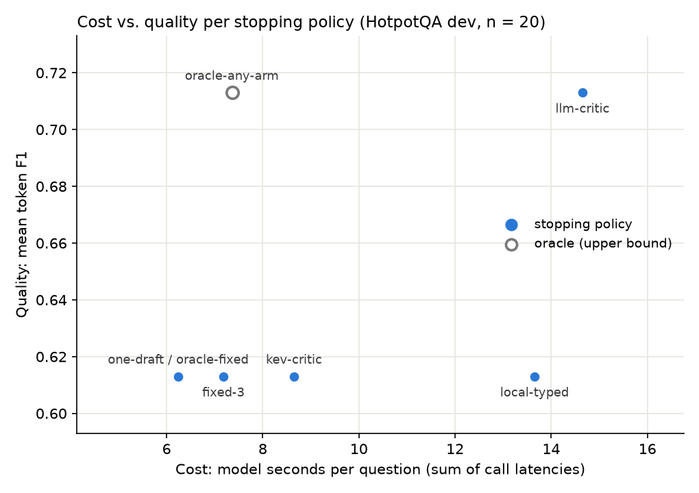

# Stopping policies: cost vs. quality

Split: **dev**, 20 questions, from 1 source(s). Generated by `compare.py` from `results/*.jsonl`; no model calls.

Baseline: **fixed-3** (always revise to the round cap). "Saved" = 1 − cost / baseline cost (negative = costs more). ΔF1 = F1 − baseline F1.

| Policy | Source | n | EM | F1 | Avg rounds | Avg tokens | Avg seconds | Tokens saved | Seconds saved | ΔF1 |
|---|---|---:|---:|---:|---:|---:|---:|---:|---:|---:|
| one-draft | run-20260928T234403183653Z | 20 | 55% | 0.613 | 1.00 | 1,777 | 6.24 | 67% | 13% | +0.000 |
| oracle-fixed (upper bound) | run-20260928T234403183653Z | 20 | 55% | 0.613 | 1.00 | 1,777 | 6.24 | 67% | 13% | +0.000 |
| fixed-3 | run-20260928T234403183653Z | 20 | 55% | 0.613 | 3.00 | 5,406 | 7.18 | 0% | 0% | +0.000 |
| oracle-any-arm (upper bound) | run-20260928T234403183653Z | 20 | 65% | 0.713 | 1.10 | 2,333 | 7.36 | 57% | -3% | +0.100 |
| kev-critic | run-20260928T234403183653Z | 20 | 55% | 0.613 | 3.00 | 11,144 | 8.65 | -106% | -20% | +0.000 |
| local-typed | run-20260928T234403183653Z | 20 | 55% | 0.613 | 1.10 | 4,088 | 13.65 | 24% | -90% | +0.000 |
| llm-critic | run-20260928T234403183653Z | 20 | 65% | 0.713 | 1.20 | 4,485 | 14.65 | 17% | -104% | +0.100 |

## Critic-bench stop rules (first draft only, 200 `extra` dev questions)

**Not on the same scale as the table above.** These 200 questions only have a first draft, so each rule is scored as *"stop after round 1 if the rule approves"*: how many drafts it stops on, and how good those are. What happens after a rejection (more rounds) was not run, so there is no final F1 for rejected drafts. Writer cost for the first draft: 8.3 s per question (qwen3:8b), the same for every rule; critic cost is extra. Jev is a paid API (cost from its budget ledger); every other critic runs locally. Strict exact-match label.

200 drafts, 115 correct (57%).

| Rule | Stops at round 1 | EM of stopped drafts | Mean F1 of stopped drafts | Wrong stops | Right drafts sent on | Critic s per draft | API $ per draft |
|---|---:|---:|---:|---:|---:|---:|---:|
| 1. approve everything | 200/200 | 115/200 (57%) | 0.697 | 85/85 | 0/115 | 0.00 | $0 |
| 2. llm alone | 159/200 | 100/159 (63%) | 0.746 | 59/85 | 15/115 | 10.23 | $0 |
| 3. evidence_match alone | 177/200 | 111/177 (63%) | 0.746 | 66/85 | 4/115 | 0.00 | $0 |
| 4. gate: evidence_match, then llm | 149/200 | 99/149 (66%) | 0.779 | 50/85 | 16/115 | 9.21 | $0 |
| 5. laya ≥ 0.8 alone | 65/200 | 45/65 (69%) | 0.825 | 20/85 | 70/115 | 0.22 | $0 |
| 6. evidence_match = 1 AND laya ≥ 0.5 | 143/200 | 90/143 (63%) | 0.761 | 53/85 | 25/115 | 0.20 | $0 |
| 7. consistency = 1.0 AND evidence_match = 1 | 156/200 | 104/156 (67%) | 0.773 | 52/85 | 11/115 | 7.79 | $0 |
| 8. logprob ≥ 0.8 alone | 150/200 | 97/150 (65%) | 0.764 | 53/85 | 18/115 | 7.14 | $0 |
| 9. evidence_match = 1 AND logprob ≥ 0.5 | 145/200 | 95/145 (66%) | 0.766 | 50/85 | 20/115 | 6.30 | $0 |
| 10. jev ≥ 0.8 alone | 133/200 | 94/133 (71%) | 0.836 | 39/85 | 21/115 | 0.19 | $0.000091 |
| 11. gate: evidence_match, then jev ≥ 0.8 | 125/200 | 93/125 (74%) | 0.862 | 32/85 | 22/115 | 0.17 | $0.000082 |

