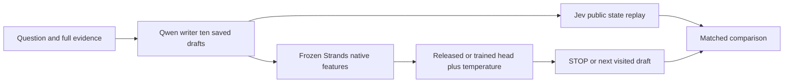

# Revision depth and head fine tuning with Strands Decider

Yash | HaltIQ research write up | October 18 2026

## Summary

I tested whether an open Strands correctness controller could use additional writer drafts effectively, and whether supervised adaptation of its existing decision head would improve those choices. I ran an untouched-model baseline before training, fitted and separately calibrated a decision head, and compared both heads with fixed draft budgets on 20 fresh HotpotQA questions. Each question had an initial answer and nine recorded revisions.

All 13 primary policies returned 10/20 exact matches (50%) and token F1 0.540. No repair, regression or answer-quality gain was observed. Eighteen answers repeated unchanged across all ten drafts. The optional Jev comparison returned the same answer scores but stronger first-decision correctness ranking on this panel: AUROC 0.915 versus 0.380 for both Strands heads. These are small-panel findings, not population equivalence or a general model ranking.

## Work completed

- Set up the actual local Strands decider and verified CUDA, model files and native inference. Tested all 20 original development questions before updating weights.

- Implemented disjoint fit, tuning and calibration stages, actual updates of the released pointer head, frozen-weight checks and save/reload verification.

- Ran common-trajectory Fixed1/2/3/5/10 controls, released/trained controllers at caps three and ten, and four predeclared visited-confidence retention variants.

- Added common-schema exports, planned-question failure accounting, question-paired uncertainty, separate physical expense reporting and the optional Jev replay.

## Dataset

HotpotQA distractor questions retain the complete supplied evidence, paragraph titles and sentence order. Only question, evidence and current draft enter the decider. Gold answers and supporting-fact labels stay evaluator-only. TRAIN and validation cohorts are disjoint, checked by ID and normalized question. Seed-42 answer-blind hash selection preserves the original training partitions.

| Cohort | N | Role |
| --- | --- | --- |
| Original development | 20 | Untouched baseline before any updates |
| Adopted TRAIN | 90 | 60 fit / 15 tuning / 15 calibration |
| Fresh public validation | 20 | 16 bridge / 4 comparison; ten drafts each |

Fresh IDs were frozen before writer or critic outcomes. This is public validation, not the official hidden test. The 200 draft states are clustered within 20 independent questions. Earlier incomplete 600-question preparation is separate from the executed TRAIN90 source and its expense.

## Environment

| Component | Recorded configuration |
| --- | --- |
| Local PC | Windows 11; Ryzen 7 9800X3D; RTX 5070 Ti about 16 GB VRAM; 31.06 GiB RAM |
| Runtime | Python 3.12.10; Torch 2.7.1+cu128; Transformers 5.17.0; PEFT 0.21.0 |
| Writer | Qwen3:8B, 16,384-token context, 512 maximum output tokens, temperature 0, seed 42, thinking off |
| Decider | Strands Decider 2B qwen3.5 v1 release; Qwen3.5-2B-Base; 4,096 fully rendered tokens |
| Background limits | One study GPU owner, four writer/encoder CPU threads, 7 GiB RAM and 3 GiB free VRAM reserves, deliberate rests |

The released checkpoint revision is 216d1ccb46a9e9b036eb9187b248db98480f77d4; the base revision is b1485b2fa6dfa1287294f269f5fb618e03d52d7c. Full prompts are tokenized with truncation disabled. An overflow is a recorded coverage failure, not a reason to remove a question or select gold paragraphs. There were no fresh-panel overflows.

## Architecture

Strands is a binary correctness and stopping controller. It does not generate answer revisions or textual repair advice in this experiment. The frozen BF16 text torso and released rank-48, alpha-96 LoRA adapter encode the full public state. They produce one 2,048-dimensional final-position vector and two 2,048-dimensional option vectors for false and true.

The existing FP32 pointer head uses shared LayerNorm and 2,048-to-768 query/key projections. Scaled dot products produce two logits. Applying sigmoid to (true logit - false logit) / temperature gives the true probability. The rule is STOP at probability at least 0.8; otherwise visit the next generic writer revision, until the cap. No passage reranker or top-k evidence selection was used.

Figure 1. Common-trajectory evaluation. All ten writer drafts are generated first; physical native features are encoded once, then both head policies select prefixes on the same observations. Jev reads the saved public state separately and does not consume Strands feature vectors.

## Pipeline

1. Save ten full-context writer drafts per question and every actual call's usage.

2. Encode all 200 states once; keep failures in the planned denominator.

3. Replay heads at caps three and ten; retention can choose only visited drafts.

4. Compare fixed depths and Jev; keep physical work separate from replay prefix costs.

## Head fine tuning and calibration

Before learning, the untouched model completed 20 valid native development forwards. I then generated a new, disjoint TRAIN90 source. Each question supplies one first-draft state in canonical false/true option order. Native features are extracted before the official normalized exact-match label is attached. Fit has 37 correct and 23 incorrect states; tuning has 11/4 and calibration 9/6.

Only the existing six-tensor pointer head is trained: LayerNorm weight/bias of size 2,048, query/key matrices of size 768 by 2,048, and their two 768-element biases. Total trainable parameters are 3,151,360. The backbone and released adapter remain frozen.

| Training choice | Actual method |
| --- | --- |
| Loss | Plain two-option cross entropy from strict answer EM; no class weighting, KL or RL objective |
| Optimizer | AdamW; betas 0.9 / 0.95; epsilon 1e-8; weight decay 0.01 |
| Candidate fit | Learning rates 1e-5 and 5e-5; batch size 32; FP32 head; dropout 0.05; gradient clip 1.0; seed 42 |
| Selection | Minimum question-averaged tuning NLL; stop after two nonimproving epochs; maximum five epochs per candidate |
| Selected checkpoint | Learning rate 1e-5, epoch one, two saved optimizer steps; six epochs / 12 steps across all candidate work |

Both candidates actually ran three epochs before early stopping. The selected head changed by L2 norm 0.02861134; frozen components were unchanged and reloaded logits matched exactly. Fitting took about 0.509 seconds, excluding native feature encoding, startup and resource rests. That fitting duration is not an end-to-end training runtime.

The same 15 calibration questions fit separate scalar temperatures for the unchanged and trained heads: 1.438330 and 1.426638. Calibration searches 0.25 to 6 with 64 log-space golden-section steps. Its fitted NLL near 0.5505 is a fitting statistic, not held-out improvement. No LoRA, backbone or reinforcement-learning updates were performed.

## Evaluation framework and common metrics

Answer quality uses HotpotQA normalized exact match and token F1. Strict EM is also the correctness label. Repairs and regressions measure transitions from the first draft to the chosen answer. AUROC measures correctness ranking; approval precision is correct approved divided by all approved, and coverage is approved divided by all planned questions. Brier and NLL measure probability quality.

Every planned question remains in EM/F1 denominators; failures would score zero. Common result exports follow Vedanshi's v0 schema, with provenance and failures kept separately. Paired 95% intervals resample questions 5,000 times with seed 42. Weights, temperatures, threshold and cohort were fixed before fresh outcomes. This matches answer scoring and row format, not historical hardware or prompts.

## Results

Fresh20 used identical saved trajectories and full public inputs for the Strands policies. All 20 planned questions completed, with zero failed or missing episodes, repairs or regressions. Fixed controls and all four retention variants are included in the 13 primary policies.

| Policy | EM | Token F1 | Mean drafts |
| --- | --- | --- | --- |
| Fixed 1 / 2 / 3 / 5 / 10 | 50% | 0.540 | 1 / 2 / 3 / 5 / 10 |
| Released Strands cap ten | 50% | 0.540 | 5.50 |
| Trained Strands cap ten | 50% | 0.540 | 5.50 |
| Either Strands head cap three | 50% | 0.540 | 2.00 |
| Four retention variants caps three / ten | 50% | 0.540 | 2.00 / 5.50 |
| Optional Jev cap ten / cap three | 50% | 0.540 | 3.75 / 1.65 |

## First decision correctness

| Metric | Released Strands | Trained Strands | Jev |
| --- | --- | --- | --- |
| AUROC | 0.380 | 0.380 | 0.915 |
| Brier score | 0.336260 | 0.336322 | 0.141200 |
| NLL | 0.910647 | 0.910822 | 0.469715 |
| Correct approved / approved | 5/10 = 50% | 5/10 = 50% | 10/13 = 76.92% |
| Approval coverage | 10/20 = 50% | 10/20 = 50% | 13/20 = 65% |

Jev supplies probabilities without raw logits; its probability NLL uses epsilon 1e-15, with no endpoint clipping in this panel. Jev's final stopping approvals are separately 10 correct out of 14, with 14/20 coverage. These conditional approval rates must not be reported as all-question answer accuracy.

## Selected paired contrasts

| Contrast and metric | Difference | Paired 95% interval |
| --- | --- | --- |
| Trained minus released answer EM / F1 | 0 / 0 | [0, 0] / [0, 0] |
| Trained minus released first NLL | +0.000174 | [+0.000065, +0.000286] |
| Jev minus released first AUROC | +0.535 | [+0.275, +0.771] |

These are descriptive intervals from 5,000 question-paired draws on 20 observed pairs. Identical answer scores do not establish population equivalence. No multiple-comparison correction or general superiority claim is made.

## Reading the results

More drafts created no observed repair opportunities here. Eighteen questions repeated the same raw answer throughout all ten drafts; two changed incorrect wording without changing EM. Both calibrated Strands heads made the same stopping choices. Their cap-ten mean selected depth was 5.5, but final answers were no better than Fixed1. Retaining the highest confidence among visited drafts also produced no answer gain.

The trained head's AUROC matched the released control and its Brier/NLL were slightly worse. Successful weight updates and improved calibration fitting loss therefore do not establish useful fresh performance. This run does not isolate whether more fit data, more updates or a different training target would help.

## A persistent incorrect answer

For the Gilgamesh location question, the reference was 'the Waters of Death'; all ten writer drafts answered 'the shore'. Strands gave a correctness probability near 0.599 and kept revising to the cap. Jev gave 0.88 on the first draft and stopped. Both selected an incorrect answer. Rejecting an answer does not itself supply a better correction, while high confidence can still approve the same error.

## Physical expense and time

| Work | Actual fresh execution |
| --- | --- |
| Writer generation | 200 calls; 387,901 input and 1,855 output tokens |
| Strands encoder | 200 real native forwards; 364,275 encoded tokens |
| Head scoring | 110 CPU scores per head; cached features avoid repeated torso forwards |
| Optional Jev | 75 hosted calls; 163,044 input and 1,500 output tokens; $0.006847848 |

The five-stage primary campaign took about 38 minutes 25 seconds including startup and deliberate idle time. Mean selected drafts and replay prefix seconds are counterfactual costs; the writer physically generated all ten drafts. They do not prove live latency or token savings. Cumulative hosted accounting is 606 settled calls / $0.054730032 with zero reserved or unsettled; local hardware and electricity are unpriced.

Earlier TRAIN600 preparation stopped at 590 saved trajectories from 591 physical calls, with one completed but unsaved call and nine questions undispatched. That expense is counted separately and once. The completed TRAIN90 source was newly generated rather than relabeling the partial600 run.

## Limits of this experiment

Independent fresh N is 20, not 200 drafts. Head fitting used 60 first drafts and labels based on strict answer matching; later-round generalization and alternative training losses were not isolated. Native Strands has a 4,096-token limit and hosted Jev a different context capacity. Common-trajectory replay does not test live action effects. Historical development uses different cohorts. Cross-report percentages require matched question IDs, drafts, evidence, prompts, checkpoints and cost scope.

## Future ideas

### Evidence specialist feedback under Strands control

What: when Strands rejects a draft, obtain short specialist feedback cited to supplied evidence, then revise while Strands retains final STOP authority. Limit the proposed intervention to one specialist call per revision and two per question.

Why: the observed generic drafts usually repeated the same answer. The next intervention should test whether concrete evidence feedback changes the candidate rather than only changing the stopping score.

Pros: targeted corrections and citations make a proposed repair inspectable. Cons: extra calls add cost and latency; incorrect feedback can introduce new errors. Test: compare generic and cited feedback on a newly frozen disjoint panel, with matched writer settings, full role-level expense, repairs/regressions and the same answer and probability metrics.

### Budget aware STOP and VERIFY utility learning

What: learn from disjoint TRAIN continuations whether verification's expected answer benefit exceeds its token and time cost. Begin with bounded one-step full-information supervised targets before considering RL.

Why: correctness confidence is not a direct estimate of whether another action will improve an answer. The current replay can reject a wrong draft repeatedly without producing a correct alternative.

Pros: decisions would target the joint quality and budget objective. Cons: reward weights, noisy EM proxies and replay or off-policy bias can distort action value. Test: select the utility model and calibrate only on TRAIN partitions, then compare with correctness-only Strands and fixed depths on a new held-out panel. A later matched live test is needed for action effects and latency. Neither proposed idea was run here.

## Review and reproduction materials

The GitHub bundle includes public full-context cohorts, 200 recorded drafts, common-schema exports, all 13 primary policy analyses, original-versus-sanitized provenance, training/calibration proofs and the selected 12.6 MB trained head with licenses and restore instructions. Upstream source, base and released adapter are pinned download dependencies.

[Open the experiment bundle and offline verifier](https://github.com/acm-research-f26/Halt-IQ/tree/Yash/results/strands-20261018)

[Read the full 18 page professor report](https://github.com/acm-research-f26/Halt-IQ/blob/Yash/results/strands-20261018/reports/professor-review.pdf)

[Read the separate four page Jev comparison](https://github.com/acm-research-f26/Halt-IQ/blob/Yash/results/strands-20261018/reports/optional-jev-companion.pdf)

[Open the implementation and model restoration instructions](https://github.com/acm-research-f26/Halt-IQ/tree/Yash/results/strands-20261018/checkpoints/selected-head)

Offline verification loads no model and calls no API. Full native reruns require pinned upstream components, a fresh external runtime and newly reviewed paths, deadlines and resource admission. Historical portable plans are data only. The selected head is reusable but did not improve this fresh panel. No credentials, live API ledger, large upstream weights or feature caches are distributed.

Data attribution: Yang et al., HotpotQA, EMNLP 2018, CC BY-SA 4.0, https://hotpotqa.github.io/. Model attribution: Strands Decider contributors and Qwen, with pinned revisions and full selected-head licenses in the bundle. Model/evaluation source baseline 8f48a545; audited team delivery baseline 7425369. All findings describe the completed October 18 runs, not new experiments.
