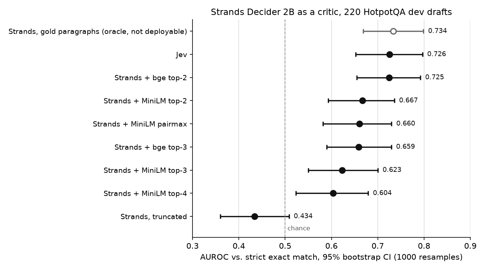

# Strands Decider 2B as a HaltIQ critic, with a reranker front-end (draft)

Status: draft for review. Every number below comes from `metrics.py` run on the two CSVs in
`results/`; the tables are pasted from `results/metrics_table.md` and `results/recall_table.md`.

## Dataset

- **Questions:** HotpotQA, distractor setting, official dev (validation) split. Each question comes
  with 10 paragraphs: the 2 gold paragraphs plus 8 distractors.[^two-paragraphs]
- **Drafts:** the same 220 first drafts used for the Jev benchmark: the 20 shared first drafts from
  Yash's Sept 28 run (critic-bench `first`) and the 200 `extra` first drafts (critic-bench `extra`).
  IDs, draft text and labels in the CSVs match critic-bench's copies for all 220.
- **Label:** strict exact match after HotpotQA normalization (`em`), 126/220 correct.
  A draft that is right but phrased differently counts as wrong.
- **Test split:** the 80 locally held-out test questions were not touched. `make_extra.py`
  excludes them by source ID and question text, and nothing here reads them.
- **`context` column:** it holds the gold paragraphs only, because it was overwritten during the
  oracle run. The reranker runs do not use it; they rebuild the 10 paragraphs from HotpotQA.

## Environment

- **Compute:** Google Colab, one NVIDIA T4 GPU.
- **Critic:** Amazon's Strands Decider 2B (`StrandsAgents/strands-decider-2B-hobson-v19`), served by
  a local `strands-decider` server inside the Colab runtime. Its score is the "noul" yes-probability
  (0 to 1) for the question *"Is the draft answer correct and fully supported by the evidence?"*
- **Rerankers (evidence selection only):** MiniLM = `cross-encoder/ms-marco-MiniLM-L-6-v2` (22M
  parameters); bge = `BAAI/bge-reranker-base` (278M). Each one scores each of the 10 HotpotQA
  paragraphs, formatted as "Title: sentences", against the query *question + draft*.
- **Writer:** qwen3:8b drafts from earlier runs, reused unchanged. No new drafts were written.
- **Jev:** scores reused from the critic-bench Jev run (official Jev API, through Yash's
  `JevCritic`), joined by question ID. No API keys are stored anywhere in this folder.
- **Timing:** mean seconds per decision on the T4, as recorded in the CSV (`sec_top3`, `sec_pairmax`):
  0.67 s for MiniLM top-3 and 3.13 s for pairmax. These times cover only the
  Strands call(s), not reranking. Timing was not recorded for the other variants.

## Architecture

**Baseline: the truncation problem.** Strands takes a bounded context, so the baseline joins all
10 paragraphs with spaces (no titles) and keeps the first 3,000 characters. Gold paragraphs that come late in the list can be cut
off, which leaves the critic judging the draft mostly against distractors.

**Reranker front-end.** A cross-encoder ranks the 10 paragraphs by relevance to question + draft.
Only the top-k paragraphs go to Strands. This keeps the context short and gives the gold
paragraphs a better chance of getting in.

*Limitation:* the reranker query includes the draft. For a wrong draft, it may favor paragraphs
that mention the wrong entity, which could make a wrong answer look supported. A question-only
query is the cleaner alternative to test.

**Pairwise aggregation variant.** HotpotQA needs two paragraphs together (a bridge or a
comparison). The variant takes the reranker's top-4, scores Strands on each of the 6 paragraph
pairs,[^two-paragraphs] and combines the 6 scores: max (`pairmax`, the main variant), mean, or second-highest.

```
                    question + draft
                           |
     10 HotpotQA paragraphs (2 gold + 8 distractors)
                           |
   baseline:  concat -> cut at 3,000 chars ---------------------> Strands -> score
                           |
   reranker:  cross-encoder (MiniLM or bge) ranks 10 paragraphs
                           |
              +------------+------------------------------+
              |                                           |
          top-k (k = 2, 3, 4)                    top-4 -> 6 pairs
              |                                           |
          Strands -> score                     Strands x 6 -> max / mean / 2nd
                                                          |
                                                        score
   decision: approve (stop) if score >= 0.8, else revise
```

The gold-paragraphs-only run (`strands2`) feeds Strands exactly the 2 gold paragraphs. It needs
the gold labels, so it is an **upper bound and cannot be deployed**. Recall (whether both gold
paragraphs made the top-k) is a diagnostic only and is never used at inference.

## Results

220 HotpotQA dev drafts (qwen3:8b), 126 correct by strict exact match (57%). AUROC 95% CI: 1000-sample bootstrap over drafts, seed 0. Approve = score >= 0.8. Precision = share of approved drafts that are correct.

| Critic | Context | AUROC (95% CI) | Approve rate | Precision | Wrong approvals |
|---|---|---:|---:|---:|---:|
| Strands, truncated | first 3,000 chars of the 10 paragraphs | 0.434 (0.360–0.508) | 16/220 (7%) | 56% | 7/94 |
| Strands + MiniLM top-2 | MiniLM reranker top-2 paragraphs | 0.667 (0.593–0.736) | 103/220 (47%) | 70% | 31/94 |
| Strands + MiniLM top-3 | MiniLM reranker top-3 paragraphs (pre-chosen headline) | 0.623 (0.550–0.700) | 74/220 (34%) | 72% | 21/94 |
| Strands + MiniLM top-4 | MiniLM reranker top-4 paragraphs | 0.604 (0.523–0.679) | 77/220 (35%) | 65% | 27/94 |
| Strands + bge top-2 | bge-reranker-base top-2 paragraphs | 0.725 (0.655–0.792) | 128/220 (58%) | 72% | 36/94 |
| Strands + bge top-3 | bge-reranker-base top-3 paragraphs | 0.659 (0.590–0.729) | 90/220 (41%) | 70% | 27/94 |
| Strands + MiniLM pairmax | max over the pairs from MiniLM top-4 | 0.660 (0.582–0.730) | 134/220 (61%) | 67% | 44/94 |
| Strands + MiniLM pair mean | mean over the pairs from MiniLM top-4 | 0.548 (0.468–0.623) | 13/220 (6%) | 69% | 4/94 |
| Strands + MiniLM pair 2nd | 2nd-highest pair from MiniLM top-4 | 0.599 (0.521–0.671) | 77/220 (35%) | 68% | 25/94 |
| Strands, gold paragraphs | gold paragraphs only (oracle, not deployable) | 0.734 (0.669–0.799) | 135/220 (61%) | 72% | 38/94 |
| Jev | Jev's own harness context (not reranked) | 0.726 (0.652–0.797) | 146/220 (66%) | 71% | 42/94 |



**Reranker recall (diagnostic only)**

Share of drafts whose **both** gold paragraphs are in the reranker's top-k (diagnostic only; never used at inference).

| Reranker | recall@2 | recall@3 |
|---|---:|---:|
| MiniLM cross-encoder | 126/220 (57%) | 165/220 (75%) |
| bge-reranker-base | 184/220 (84%) | 203/220 (92%) |

**Reading the results**

- **Truncation is the problem.** On the truncated context, Strands is indistinguishable from
  chance: AUROC 0.434 (0.360–0.508), and its 95% CI includes 0.5. Every reranked variant scores above it.
- **Pre-chosen headline: MiniLM top-3.** This configuration was chosen before any results were
  seen: AUROC 0.623 (0.550–0.700). It is the only reranked configuration that was not picked after seeing these drafts' results.
- **Explored after seeing results (same 220 drafts):** the bge reranker and other values of k.
  The best of these, **bge top-2, AUROC 0.725 (0.655–0.792)**, is close to Jev
  (0.726 (0.652–0.797)) and to the gold-paragraph oracle (0.734 (0.669–0.799)). But it was picked from
  several options on the very drafts it is scored on, so it is optimistic. **It needs confirming
  on fresh drafts** before it can be called a result. All the reranked variants have overlapping
  CIs. No paired test was run.
- **Smaller k did better here** for both rerankers (top-2 above top-3 above top-4 for MiniLM).
  bge also gets both gold paragraphs into its top-k far more often than MiniLM (recall table).
  That fits the idea that evidence selection is the bottleneck, but it is a correlation seen
  after the fact, not a tested cause.
- **Pairmax** (AUROC 0.660 (0.582–0.730)) does no better than plain MiniLM top-2. It costs
  up to 6 Strands calls per draft instead of 1 (see Timing above) and has the most wrong approvals of
  the reranked variants at 0.8.
- **At the 0.8 threshold,** precision for every critic except the truncated baseline sits in a
  narrow band above the base rate of 57%. The truncated baseline approves few drafts, and
  its precision is about the base rate. The variants differ mostly in how many drafts they approve, not in
  how clean the approvals are. The 0.8 threshold comes from Yash's loop and was not tuned for
  Strands.
- **Jev is not a like-for-like comparison.** Jev was scored with its own harness context (the
  evidence in Yash's task format), not the reranked evidence that Strands saw.
- **Strict label.** Every number uses strict exact match, so critics that accept correct answers
  phrased differently are penalized.

[^two-paragraphs]: 2 of the 220 questions have only 2 paragraphs (both gold), so reranking can't
    change them: top-2, top-3, top-4 and pairmax all give the same score, from a single pair.

## Future ideas

### 1. Fine-tune Strands on retrieved HotpotQA evidence (LoRA)

**What:** build training examples from the HotpotQA train split (never dev/test): question, bge top-2
evidence, a writer draft, and the exact-match label. Fine-tune Strands Decider 2B with LoRA adapters
to output the yes-probability on this format.

**Why:** today's results show Strands is sensitive to how evidence is presented (fewer paragraphs
scored better, and the model card warns yes/no answers transfer poorly to new tasks). Fine-tuning
teaches it this exact input format and should improve calibration at the 0.8 threshold, not just
ranking.

**Pros:**
- adapts the model to multi-paragraph, retrieved (imperfect) evidence;
- LoRA is cheap enough for a single T4/A100 session;
- keeps the same cheap inference cost.

**Cons:**
- needs labeled train drafts, so the writer must run on new questions (hours of generation);
- risk of overfitting to HotpotQA and losing generality;
- labels are strict exact match, so near-miss answers become noisy negatives.

**Test:** same 220 dev drafts plus fresh drafts, same metrics; compare against bge top-2 at 0.725.

### 2. Calibrated cascade: free check -> reranked Strands -> Jev only when uncertain

**What:** run the free evidence-match check first; send survivors to reranked Strands; call Jev only
when Strands' score falls in an uncertain band (e.g. 0.4-0.8). Combine the signals with a small
logistic calibrator.

**Why:** reranked Strands and Jev now reach similar AUROC (0.725 vs 0.726) but disagree on
which drafts to approve (128 vs 146 approvals at 0.8). Earlier critic-bench work showed gating
Jev behind the free check cut wrong approvals. A cascade could keep Jev-level quality while paying
for Jev on only a fraction of drafts.

**Pros:**
- directly targets the project's cost-vs-quality question;
- reuses critics we already have;
- each stage is cheap and interpretable.

**Cons:**
- more moving parts and thresholds to tune;
- the calibrator needs its own held-out data, which our 220 drafts can't provide without leakage;
- errors can compound if the first stage wrongly rejects correct drafts.

**Test:**
